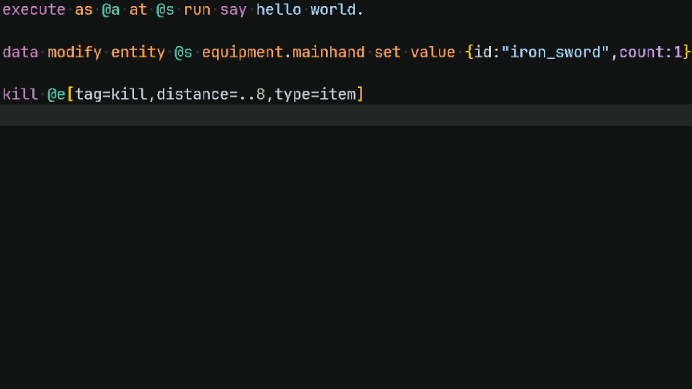
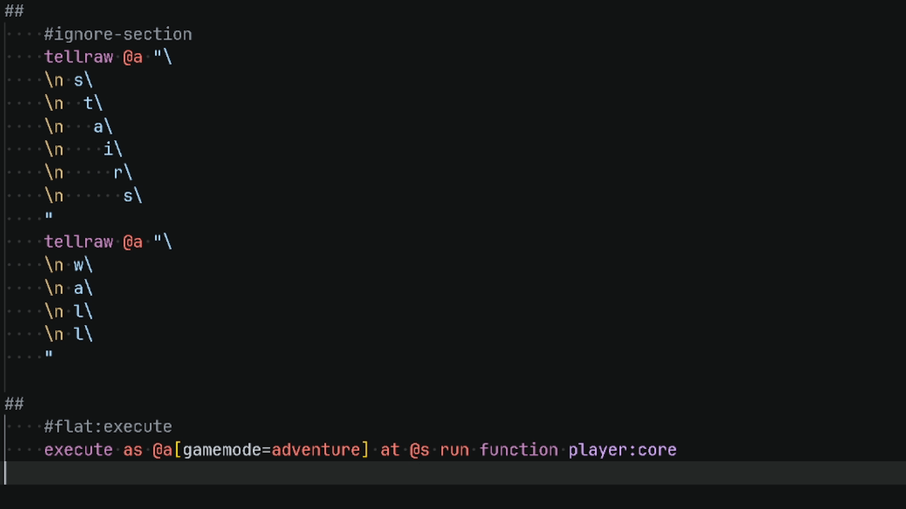
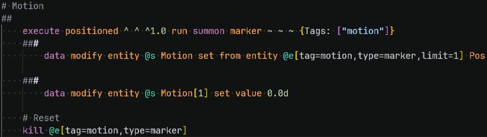

# mcfunctionFormatter

  

[English](README.md) | 日本語

Minecraft Java Editionの1.21以降におけるデータパック`.mcfunction`用のフォーマッターです。executeやNBTの展開、コメントに応じたインデントなどを実装しています。

## コードの展開

executeコマンド、NBT/JSON、セレクターを展開または整形することができます。

  

(executeの展開には、`pack.mcmeta`と初回のみインターネットを必要とします。そうでない場合、通常のコマンドと同様の振る舞いをします。)

### コメントによる指定

`#<key>[-<scope>][:<kinds>]`の形のコメント行により設定を部分的に上書きできます。

- **key** : どのような振る舞いをするか
  - `ignore` : 書かれたまま残す
  - `expand` : 展開する
  - `flat` : 1行に整える
- **scope** : どの範囲に影響を及ぼすか
  - なし : 次のコマンド1つのみ
  - `-section` : 今いるセクション。子セクションには及ばない
  - `-all` : 子セクションも含む
- **kinds** : どのタイプに影響させるか
  - `execute` / `selector` / `nbt` / `attached` をカンマ区切りで指定
  - 省略により以上のすべてを指定

  

## インデント

`#`1つで通常のコメント、`#`を2つ以上重ねることで数に応じてインデントを制御します。

  

## その他

- `#> namespace:path` をファイル先頭に自動追加します。（パスが違う場合は上書き）
- `:`、 `,`、 `=`における空白の整形をします。

## 出典

コマンド構文のデータとして以下を使用しています。

- [misode/mcmeta](https://github.com/misode/mcmeta)
