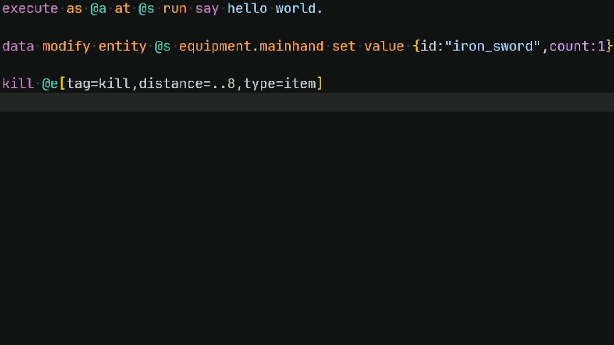
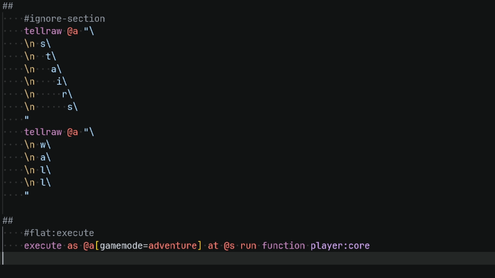
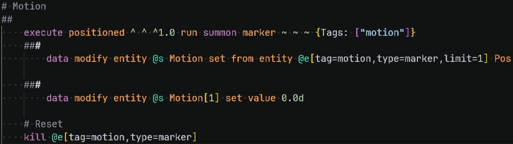

# mcfunctionFormatter

  

English | [日本語](README.ja.md)

A formatter for `.mcfunction` files in Minecraft Java Edition 1.21+ data packs. It expands `execute` commands and NBT, indents by comments, and more.

## Expanding code

`execute` commands, NBT / JSON and selectors can be expanded or tidied.

  

(Expanding `execute` needs the data pack's `pack.mcmeta`, and an internet connection the first time. Without them, `execute` is formatted like any other command.)

### Comment directives

A comment line of the form `#<key>[-<scope>][:<kinds>]` overrides the settings for part of the file.

- **key**: what to do
  - `ignore`: keep as written
  - `expand`: expand
  - `flat`: tidy on one line
- **scope**: where it applies
  - none: the next command only
  - `-section`: the rest of the current section, not its child sections
  - `-all`: the current section, child sections included
- **kinds**: what it applies to
  - a comma-separated list of `execute` / `selector` / `nbt` / `attached`
  - all of them when omitted

  

## Indentation

A single `#` is a plain comment. Headings with two or more `#` set the indentation by their number of `#`.

  

## Other features

- Adds a `#> namespace:path` header at the top of the file (and overwrites it when the path differs).
- Formats the spacing around `:`, `,` and `=`.

## Credits

The command syntax data comes from:

- [misode/mcmeta](https://github.com/misode/mcmeta)
